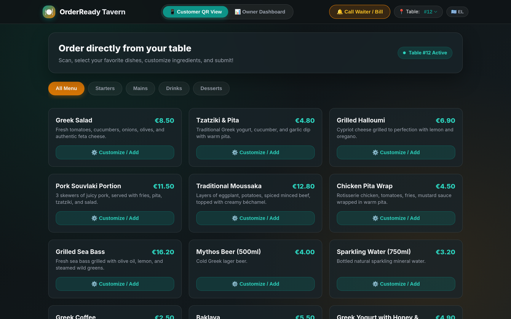
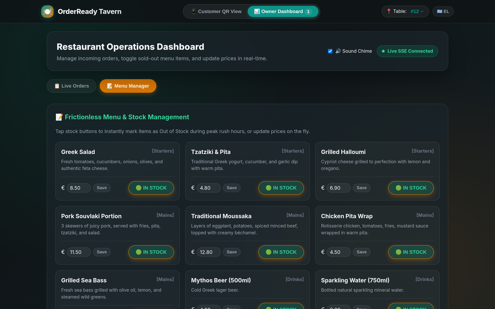
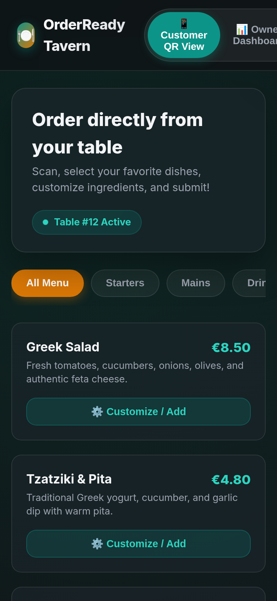
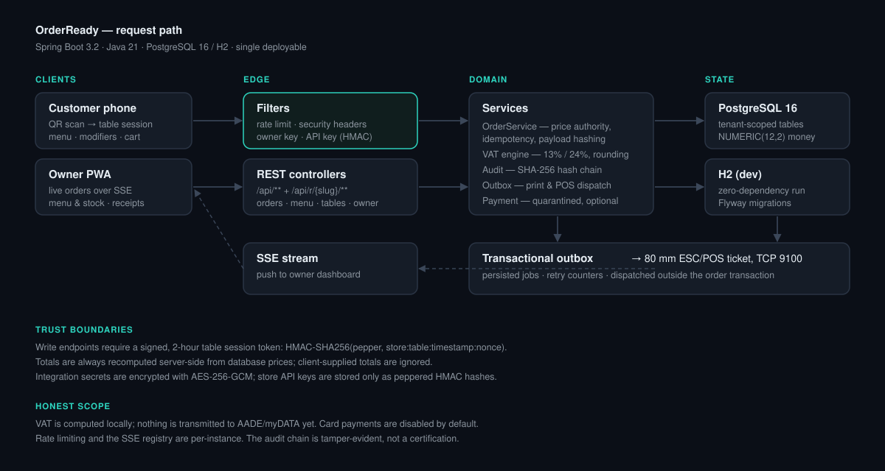

# OrderReady

**Multi-tenant QR ordering and a live kitchen dashboard for restaurants — one self-hosted Java 21 / Spring Boot service.**

`Java 21` · `Spring Boot 3.2` · `Spring Data JPA` · `PostgreSQL 16` · `Flyway` · `Docker`

> **Source code is private.** This repository is a technical showcase. The full source is
> available on request for interviews and technical evaluation — see [Source access](#source-access).

OrderReady lets a guest scan the QR code on their table, order and customise dishes from their
phone, and pay at the table — while staff watch orders arrive live on a tablet dashboard that
prints kitchen tickets directly, with no POS register required.

## What it does

**For the guest** — a mobile-first menu scoped to their table. Dishes can be customised
(remove ingredients, add paid extras), coffee orders take their modifiers, and the cart sends
the order to the kitchen. A waiter call and bill request are one tap.

**For the owner** — a PWA dashboard with live order arrival over SSE, status transitions,
1-tap stock toggles and live price edits. Kitchen tickets print over raw TCP to a network
thermal printer, so the product works standalone without third-party middleware.

  
  

## Engineering highlights

**Multi-tenancy.** Every table is scoped by `restaurant_id`, from menu items to orders, payments
and the live SSE broadcast. The same deployment serves many restaurants, each reachable under
`/api/r/{slug}/…`.

**Physical-world security.** Scanning a table issues a signed, 2-hour session token —
`HMAC-SHA256(pepper, store:table:timestamp:nonce)`. Write endpoints reject requests without it,
so nobody can flood a restaurant's tables remotely without having scanned the QR code.

**Server-side price authority.** Totals are recomputed from database prices on every order;
client-supplied prices are ignored. Idempotency keys are scoped per store
(`UNIQUE (restaurant_id, idempotency_key)`) and paired with a SHA-256 payload hash, so replaying
a request with modified modifiers is rejected rather than silently accepted.

**Concurrency.** Webhook and browser-redirect confirmations are serialised with
`SELECT … FOR UPDATE`, preventing double fulfilment. The write path is exercised by a real HTTP
stress test that fires 40 concurrent orders and asserts every one returns `201`.

**Greek VAT, done properly.** Prices are gross-inclusive at 13% (food) and 24% (beverages).
Because per-line AADE rounding cannot simultaneously satisfy the tax authority and the exact
settlement total, the engine stores the residual as a document-level rounding adjustment —
`BigDecimal` end to end, `NUMERIC(12,2)` in the database.

**Tamper-evident audit trail.** Every event is appended as
`SHA256(previousHash + seq + type + entity + timestamp + payload)` and can be verified live.
This is tamper *evidence*, not an ISO 27001 certification, and is described as such.

**Secrets and keys.** Integration secrets are encrypted at rest with AES-256-GCM. Store API
keys are stored only as server-peppered HMAC-SHA256 hashes — no plaintext keys in the database.

**Reliability.** Kitchen printing and POS pushes go through a transactional outbox, so a printer
that is offline or slow cannot fail or delay the order transaction.

## Architecture

The service is a single Spring Boot deployable: servlet filters (rate limiting, security
headers, owner/API-key auth) → REST controllers → domain services → JPA repositories. The
production profile points at PostgreSQL 16 with Flyway migrations; the dev profile runs on an
in-memory H2 database so the app starts with no external dependencies.

## Testing

The gate is `mvn -B verify` — compile, JUnit suite, package. It covers:

- `OrderReadyHttpStressTest` — 40 concurrent `POST /api/orders`, all must return `201`
- `PaymentRaceConditionTest` — concurrent webhooks under pessimistic locking
- `MyDataIsoCertificationTest` — VAT split and audit hash-chain verification
- `OrderReadyIntegrationTest` — order creation and payment-intent idempotency

SpotBugs runs report-only at `verify`; the OWASP dependency scan runs under the opt-in
`-Psecurity` profile.

## Status, stated honestly

| Area | State |
| --- | --- |
| Multi-tenant ordering, kitchen tickets, SSE dashboard | Implemented and tested |
| Signed QR session tokens, idempotency, price authority | Implemented and tested |
| Greek VAT engine and audit hash chain | Implemented and tested |
| AADE / myDATA transmission | **Not yet** — fiscal identifiers are local placeholders |
| Card payments | **Disabled by default** — gateway choice still open |
| Rate limiting, SSE registry | In-memory, per instance |

Publishing a limitations table is a deliberate choice: an ordering system's value is in the
unglamorous parts, and pretending otherwise wastes a reviewer's time.

## Source access

The source is private while the product is being prepared for commercial release. I am happy to
grant read access or walk through the code in an interview or technical review — open an issue
on this repository and I will get back to you.

## Licence

This repository contains documentation and screenshots only. Documentation and images are
© 2026 Evangelos Moschou; the underlying source code is not included here and is licensed
separately under the PolyForm Noncommercial License 1.0.0.
